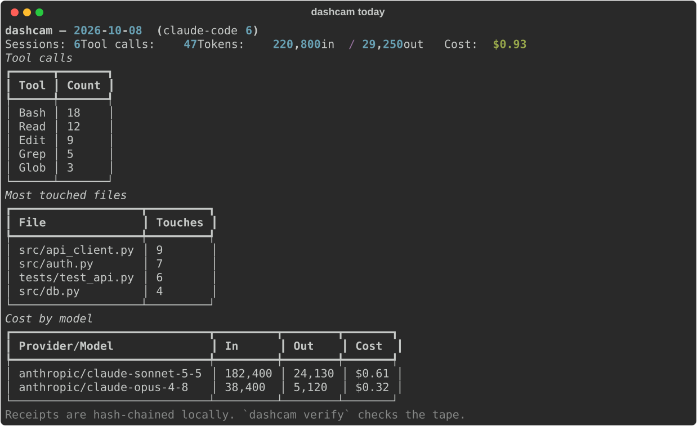
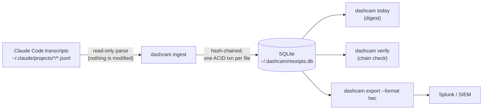

<div align="center">

# dashcam

**The dashcam for your AI coding agents.**

[](https://github.com/Varshith-Kali/dashcam/actions)
[](https://www.python.org/)
[](LICENSE)

*A dashcam doesn't stop the car. It records.*



</div>

## The problem

Your coding agents take hundreds of actions a day — reading files, running commands, calling models. When something goes wrong (a bad deploy, a surprise bill, an auditor's question), you have **no tape**:

- **Harness logs exist but nobody reads them.** Claude Code writes every session to `~/.claude/projects/`, but it's raw JSONL exhaust — no digests, no cost, no verification.
- **Your SIEM doesn't see it.** Agent activity lives on developer laptops. Nobody pays Splunk ingest pricing for "agent ran `ls` 400 times" — so the tool-call tape simply never reaches the SOC.
- **Cost is invisible until the invoice.** Tokens scatter across providers and models with no per-session attribution.

dashcam reads the logs your agents *already write* and keeps **tamper-evident receipts**: every tool call, every token, every dollar. Read-only. Local-first. Nothing leaves your machine unless you say so.

## What it is

- **Session receipts** — every agent session parsed from the harness's own logs into local SQLite, each row hash-chained (`sha256(prev_hash + record)`). `dashcam verify` proves the tape wasn't altered.
- **Cross-provider cost** — token usage converted to USD per provider/model from a community price table. No proxy, no MITM, no behavior change.
- **`dashcam today`** — the daily digest: sessions, tool calls, files touched, tokens, spend. The one command worth running every day.
- **SIEM-ready** — `dashcam export --format hec` emits Splunk HEC events. dashcam is the edge sensor; your SIEM stays the system of record. See [docs/SIEM.md](docs/SIEM.md).

## What it is not

- **Not a firewall.** dashcam never blocks, prompts, or restrains your agent. Blocking sidecars get bypassed by the agent, fatigue the user, and get uninstalled — we chose the other side of that trade on purpose. The tape doesn't lie, and it doesn't nag.
- **Not a cloud service.** No accounts, no servers, no telemetry. Receipts live in `~/.dashcam/receipts.db`.

## Already have Splunk?

Then you know the gap: your SIEM sees EDR process events and proxy logs — *that something ran* — but not the agent's tool-call sequence. dashcam records the tape where the work happens (free, zero-config) and forwards clean JSONL to HEC when you're ready:

```bash
dashcam export --format hec | curl -H "Authorization: Splunk $HEC_TOKEN" \
  --data-binary @- https://your-splunk:8088/services/collector/event
```

Regulators are asking for exactly this artifact: the EU AI Act (Art. 12, enforceable since Aug 2026) requires high-risk AI systems to keep **tamper-evident** event logs; SOC 2 and ISO 42001 demand the same discipline. dashcam produces the receipt; your SIEM keeps it. Full mapping in [docs/SIEM.md](docs/SIEM.md).

## Quickstart

```bash
pipx install dashcam        # or: pip install dashcam
dashcam demo               # 60-second tour on a scratch DB — your receipts stay clean
dashcam ingest             # read your real Claude Code session logs (read-only, resumable)
dashcam today              # what did my agents do today?
dashcam runs               # sessions with tool calls, tokens and cost each
dashcam verify             # prove the receipts weren't tampered with
dashcam export             # dump receipts as JSON (or --format hec for Splunk)
```

## How it works



Each recorded row seals the previous one into a SHA-256 chain. Delete or alter a row and `dashcam verify` fails — the same tamper-evidence idea behind signed audit logs, running entirely on your laptop. Details in [docs/ARCHITECTURE.md](docs/ARCHITECTURE.md).

## Security

Full threat model in [SECURITY.md](SECURITY.md). The short version:

- **Tamper-evident, not tamper-proof** — stated honestly, with the upgrade path documented.
- **Secret redaction** — command text is scrubbed for recognizable secrets before persistence; full prompts are never stored.
- **Local-only** — no network code, no telemetry. DB is `0600`, directory `0700`.
- **Crash-safe** — per-file ingestion is one ACID transaction; concurrent writers can't fork the chain (WAL + `BEGIN IMMEDIATE`).

## Cost data

Prices live in [`src/dashcam/data/models.json`](src/dashcam/data/models.json) (USD per 1M tokens). Providers change prices; when they do, send a PR that touches *only* that file. If the table is stale, drop your own `~/.dashcam/pricing.json` (same format) — it overrides the packaged table without a reinstall.

## Roadmap

- **v0.1** — Claude Code transcripts, hash-chained receipts, cost, digest, demo, verify, SIEM export (this release)
- **v0.2** — more harness parsers (opencode, Gemini CLI), `dashcam serve` (localhost read-only timeline)
- **v0.3** — optional BYOK digest summarizer (your own key, off by default)

See [docs/ROADMAP.md](docs/ROADMAP.md). Principle: **narrow beats bundle** — a feature ships only if it makes the receipts more trustworthy or more useful.

## Honest comparisons

- **vs. blocking sidecars** (pre-execution firewalls): they restrain, we record. Restraint gets bypassed and fatigues users; recording can't be bypassed and never nags. Different jobs.
- **vs. session scorers** (e.g. `agent-dashcam`): they grade your agent's *quality*; we keep the *evidence*. The tape comes before the verdict.
- **vs. agentmetry** (closest in spirit — local-first flight recorder, hash-chained): they go wider (MITRE mapping, detections, DLP, blocking modes) via IDE hooks; we stay narrow (receipts + cost + digest) and read-only — no hooks to install, none to bypass. Early days for both; pick the philosophy you want.

## Contributing

PRs welcome. The bar: deterministic, read-only, tested. Every parser change needs fixture transcripts in `tests/`; price updates touch only the pricing file. See [CONTRIBUTING.md](CONTRIBUTING.md).

## License

MIT — see [LICENSE](LICENSE).
